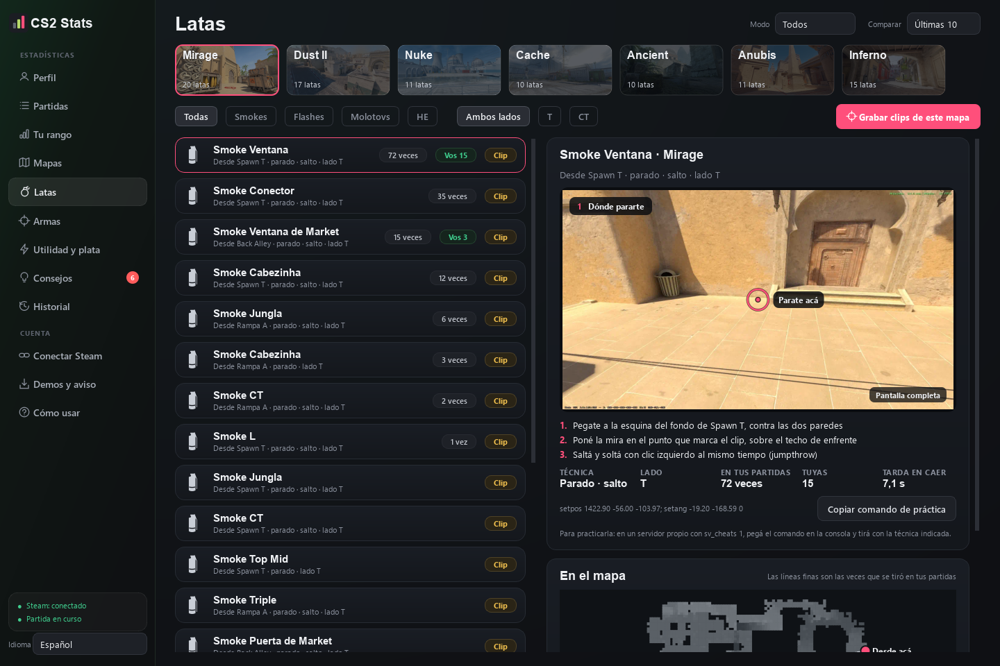
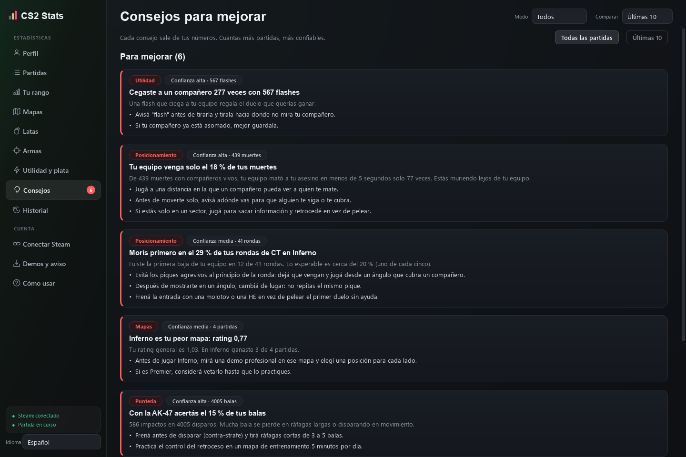
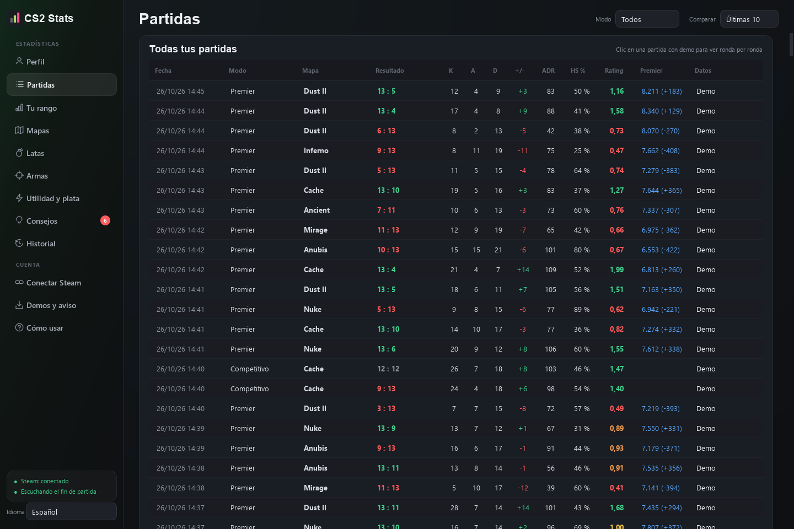

# CS2 Stats

[English](README.md) · **Español**

App de escritorio para Windows que junta tus partidas de Counter-Strike 2 (Premier, Competitivo y FACEIT), guarda todo tu historial en tu PC, compara tus números con los jugadores de tu rango de Premier y te dice qué practicar. También trae una biblioteca de latas con clips grabados en el juego y te puede mandar por Steam lo mejor de cada partida.

Todo corre en tu PC con herramientas oficiales de Valve. Nunca lee ni toca la memoria del juego: no hay riesgo de VAC.

## Qué hace

* **Importa tus partidas solas.** Como Leetify, pero en tu PC: con tu código de autenticación de Steam, la Match History API y una cuenta secundaria en el Game Coordinator de CS2, las demos nuevas de Premier se bajan y se analizan solas unos minutos después de cada partida.
* **Todo tu historial de CS2** desde la página oficial "Datos personales del juego" de Steam (iniciás sesión una vez con QR).
* **Métricas por partida y en el tiempo:** rating, ADR, KAST, primeros duelos, kills de cambio, clutches, utilidad, economía, ronda por ronda, por mapa, por arma y CT contra T.
* **Detalle de cada partida al estilo Leetify,** para los 10 jugadores y con sus fotos de Steam: tus 5 mejores números de la partida contra tus últimas 30; impacto (cuánto movió cada uno la probabilidad de ganar, total, como T y como CT, por tipo de jugada y ronda por ronda); puntería (tiempo al daño, ubicación de la mira, precisión a la cabeza, primera bala, ráfaga y counter-strafe); utilidad (calidad, cantidad, ceguera, daño de HE y granadas sin usar al morir); y cara a cara contra cada rival, con la matriz de duelos. El Premier se muestra con la placa del juego.
* **FACEIT aparte de Premier:** con una clave gratis de la API de datos de FACEIT, la app trae tu nivel, tu ELO (y cómo cambia) y tus partidas de FACEIT con K/D, ADR y HS %. Con el filtro de modo de arriba cada modo muestra sus números por separado; arranca en Premier y recuerda el que elijas.
* **Comparación con tu rango:** cada métrica contra jugadores de tu mismo color de Premier sacados de tus propias demos, con dónde destacás y dónde estás por debajo.
* **Consejos** armados con tus números, con qué tan confiable es cada uno.
* **Latas:** las smokes, molotovs y flashes más conocidas de Mirage, Dust II, Inferno, Ancient, Anubis, Nuke y Cache, cada una probada en CS2, con el nombre del call (Ventana, Jungla, Cabezinha, CT, Triple, Caja de fuego, L...). Cada lata tiene un clip grabado en el juego en tres partes (dónde pararte, adónde apuntar y cómo cae), los pasos y cuántas veces se tiró en tus partidas. Con un clic se ve en pantalla completa.
* **Mensaje de Steam al terminar cada partida:** tu cuenta secundaria te escribe por el chat, como un amigo, con lo mejor de tu partida (multikills, clutches, récords de ADR).
* **Repetición 2D de cada partida:** los 10 jugadores sobre el mapa, ronda por ronda, con barra de tiempo, velocidad, granadas, bomba, disparos y kills, para revisar ejecuciones, rotaciones y retakes.
* **Jugadas automáticas:** la app busca tus ases, 4K, 3K y clutches ganados, y también tus errores (morir sin disparar, flashes que cegaron a 2 o más compañeros). Cada una se mira como un clip corto de la repetición o se guarda como MP4 o GIF, sin abrir el juego ni bajar la demo de nuevo.
* **Mapa de calor** de dónde matás y dónde morís en cada mapa, con las zonas que más se repiten. Con **muertes tempranas** ves dónde caés en los primeros 30 segundos, por lado (por ejemplo: "En Mirage como T el 35 % de tus muertes tempranas son en Top Mid").
* **Vos y tus amigos:** cara a cara con los compañeros con los que más jugás, en las mismas partidas, y la **sinergia** con cada uno: cuánto ganás juntos y separados, sus flashes efectivas y kills de cambio. Además, quién del grupo es el Entry Assistant y quién el Lurk / Saver.
* **Asistente pre-partida:** cargá a tus compañeros y a los rivales (tu grupo de Steam se detecta solo, o pegás perfiles, nombres o la salida de `status`) y la app sugiere qué mapas pickear y banear, y marca a los rivales peligrosos, AWPers y entry fraggers. Con una sala de FACEIT y una clave gratis de la API de FACEIT suma los números de FACEIT de los 10.
* **Entrenamiento:** 3 retos nuevos cada lunes armados con tus puntos flojos (kills de cambio en tu mapa, ADR en partidas seguidas, partidas sin cegar compañeros…) y mapas gratis del Workshop de CS2 con una rutina concreta para cada cosa (Aim Botz, Recoil Master, Yprac, prefires).
* **Logros y metas:** 20 medallas (as, clutches, rachas, colores de Premier…), metas propias con barra de progreso y un pronóstico de Premier para tus próximas 10 partidas.
* **Música del mapa:** la canción de cada mapa, sacada de tus archivos de CS2, suena al abrir una partida o tocar un mapa, y hay una radio de mapas con control de volumen.
* **Español e inglés.** El idioma se elige abajo en la barra lateral.

| Consejos | Partidas |
|---|---|
|  |  |

## Instalación

1. Bajá `CS2Stats-windows.zip` de la [última versión](../../releases/latest).
2. Descomprimilo donde quieras y abrí `CS2Stats.exe`. La carpeta `clips` que está al lado trae los clips de las latas.
3. Seguí **Conectar Steam** en la app (unos 5 minutos, una sola vez):
   1. Pegá tu **código de autenticación** y tu **último código de partida** (la app abre la página de Valve donde están).
   2. Pegá una **clave de Web API de Steam** (dominio: `localhost`).
   3. Conectá una **cuenta secundaria de Steam** con QR o con usuario y contraseña. Es una cuenta gratis que solo pide las demos; tu cuenta principal nunca queda conectada.
   4. Opcional: iniciá sesión una vez con QR con tu cuenta principal para traer todo tu historial.

Para FACEIT, bajá la demo desde la sala del partido y la app la importa desde Descargas.

## Seguridad

* Solo fuentes oficiales: Game State Integration (un archivo de texto en la carpeta `cfg` de CS2), la Match History API, los servidores de repeticiones de Valve y el Game Coordinator de CS2 con la cuenta secundaria.
* Nunca abre, lee ni modifica el proceso del juego ni su memoria.
* Los clips de latas se graban con CS2 en modo práctica (`-insecure`, servidor tuyo) y la captura de ventanas de Windows. Para volver a jugar online, cerrás CS2 y lo abrís normal.
* Las claves se guardan cifradas en tu PC con DPAPI de Windows. Nada se manda a otros servicios. La única excepción es opcional: si cargás una clave de FACEIT, el asistente pre-partida la usa para leer la sala que le pases.

## Dónde se guardan los datos

En `%LOCALAPPDATA%\CS2Stats`: `historial.db` (partidas, rondas, armas y las repeticiones 2D comprimidas), `ajustes.json` y `clips\` (los clips que grabes vos).

## Para desarrollar

* Python 3.12 con `PySide6-Essentials`, `demoparser2`, `polars`, `pandas`, `zstandard`, `segno`, `vpk`, `windows-capture`, `opencv-python` y `pyinstaller`.
* Ayudante de Steam: Node.js con `steam-user`, `globaloffensive` y `steam-session` (`cd helper && npm install`).
* Abrir: `python -m cs2stats`. Pruebas: `python -m unittest discover -s tests`.
* Empaquetar: `pyinstaller CS2Stats.spec` crea `dist\CS2Stats\CS2Stats.exe`.
* Los textos se escriben en español y se traducen con `t()` (`cs2stats/i18n.py`); el inglés está en `cs2stats/i18n_en.py`.

## Créditos

Las posiciones de las latas salen de [csnades.gg](https://csnades.gg) (más la smoke a Ventana desde Spawn T, sacada de partidas reales); cada una se tiró en CS2 y solo quedaron las que caen donde tienen que caer. Las fotos e íconos de los mapas se leen de tu CS2 instalado. CS2 Stats no está afiliado a Valve.

## Licencia

[MIT](LICENSE)
