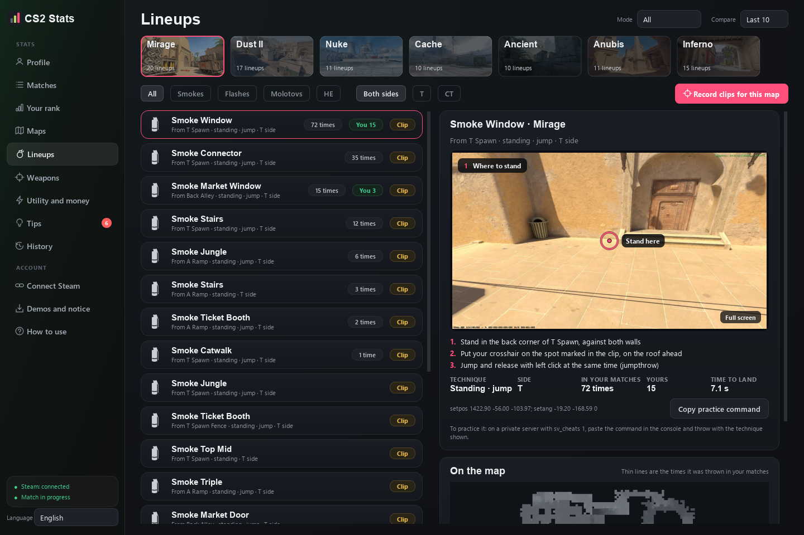
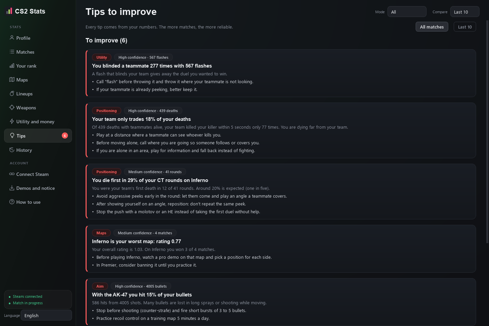
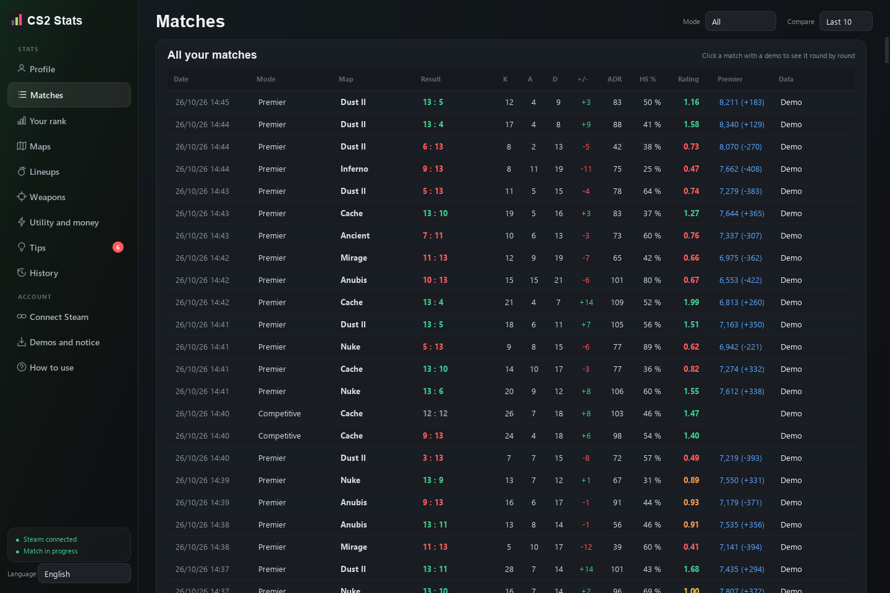

# CS2 Stats

**English** · [Español](README.es.md)

A Windows desktop app that collects your Counter-Strike 2 matches (Premier, Competitive and FACEIT), keeps your full history on your PC, compares your numbers with players of your Premier rank and tells you what to practice. It also has a lineups library with in-game clips, and it can message you on Steam with the best moments of every match.

Everything runs on your PC with official Valve tools. It never reads or touches the game's memory, so there is no VAC risk.

## Features

* **Automatic match import.** Like Leetify, but local: with your Steam authentication code, the Match History API and a secondary account on the CS2 Game Coordinator, new Premier demos download and get analyzed on their own a few minutes after each match.
* **Full CS2 history** from Steam's official "Personal Game Data" page (sign in once with a QR code).
* **Metrics per match and over time:** rating, ADR, KAST, opening duels, trades, clutches, utility, economy, round by round, by map, by weapon and CT vs T.
* **Leetify-style match details** for all 10 players, with their Steam pictures: your top 5 stats of the match against your last 30; impact (how much each player moved the odds of winning, overall, as T and as CT, by type of play and round by round); aim (time to damage, crosshair placement, head accuracy, first bullet, spray and counter-strafing); utility (quality, quantity, blind time, HE damage and unused grenades at death); and head to head against each opponent, with the duel matrix. Premier is shown with the in-game rating badge.
* **FACEIT kept apart from Premier:** with a free FACEIT Data API key, the app brings in your level, your ELO (and how it changes) and your FACEIT matches with K/D, ADR and HS%. The mode filter at the top shows each mode's numbers separately; it starts on Premier and remembers your choice.
* **Comparison with your rank:** each metric against players of your same Premier color taken from your own demos, with where you stand out and where you are below.
* **Tips** written from your own numbers, with how confident each one is.
* **Lineups:** smokes, molotovs, flashes and HEs for Mirage, Dust II, Inferno, Ancient, Anubis, Nuke and Cache, each one tested in CS2. Every lineup has a 60 FPS first-person clip recorded in game: you walk to the spot, aim, throw and see how it lands, with a marker for each step. It also has step by step instructions and how many times it was thrown in your matches. Click the clip to watch it full screen.
* **Steam message after every match:** your secondary account sends you a chat message, like a friend, with your best moments (multi-kills, clutches, ADR records).
* **2D replay of every match:** all 10 players on the map, round by round, with a timeline, speed control, grenades, the bomb, shots and kills, to review executes, rotations and retakes.
* **Automatic plays:** the app finds your aces, 4Ks, 3Ks and won clutches, and also your mistakes (dying without firing, flashes that blinded 2 or more teammates). Each one plays as a short clip of the replay or saves as an MP4 or GIF, without opening the game or downloading the demo again.
* **Open in CS2:** every play and every replay moment opens the real demo in the game, at that round and second, with the camera on your player. CS2 opens in replay mode (`-insecure`); to play online again, close it and open it normally. If CS2 is already open, the app leaves it alone and gives you the commands to paste in the console.
* **Sessions:** how much you win by match of the session, after a win or a loss, and by time of day. If the difference is large enough to trust, it tells you from which match you should stop; if not, it draws no conclusions.
* **Heat map** of where you kill and where you die on each map, with the zones that repeat the most. **Early deaths** shows where you die in the first 30 seconds, per side (for example: "On Mirage as T, 35% of your early deaths happen at Top Mid").
* **You and your friends:** head to head against the teammates you play with the most, in the same matches, plus your **synergy** with each one: how often you win together and apart, their effective flashes and trade kills. It also shows who in the group is the Entry Assistant and who is the Lurk / Saver.
* **Pre-match assistant:** add your teammates and opponents (your Steam party is detected automatically, or paste profiles, names or the `status` output) and the app suggests which maps to pick and ban, and flags dangerous opponents, AWPers and entry fraggers. With a FACEIT room and a free FACEIT API key it adds all 10 players' FACEIT numbers.
* **Training:** 3 new challenges every Monday built from your weak spots (trade kills on your map, ADR over consecutive matches, matches without blinding teammates…) and free CS2 Workshop maps with a concrete routine for each one (Aim Botz, Recoil Master, Yprac, prefires).
* **Achievements and goals:** 20 medals (ace, clutches, streaks, Premier colors…), your own goals with progress bars and a Premier forecast for your next 10 matches.
* **Map music:** each map's song, taken from your CS2 files, plays when you open a match or tap a map, plus a map radio with volume control.
* **Spanish and English.** Pick the language at the bottom of the sidebar.

| Tips | Matches |
|---|---|
|  |  |

## Install

1. Download `CS2Stats-windows.zip` from the [latest release](../../releases/latest).
2. Unzip it anywhere and open `CS2Stats.exe`. The `clips` folder next to it has the lineup clips.
3. Follow **Connect Steam** in the app (about 5 minutes, once):
   1. Paste your **authentication code** and **latest match code** (the app opens Valve's page where you get them).
   2. Paste a **Steam Web API key** (domain: `localhost`).
   3. Connect a **secondary Steam account** with a QR code or username and password. It is a free account that only requests demos; your main account is never left signed in.
   4. Optional: sign in once with QR using your main account to import your full history.

For FACEIT, download the demo from the match room and the app imports it from your Downloads folder.

## Safety

* Only official sources: Game State Integration (a text file in the CS2 `cfg` folder), the Match History API, Valve's replay servers and the CS2 Game Coordinator through the secondary account.
* It never opens, reads or modifies the game process or its memory.
* Lineup clips are recorded with CS2 in practice mode (`-insecure`, your own server) and the Windows window capture. To play online again, close CS2 and open it normally.
* Keys and tokens are stored encrypted on your PC with Windows DPAPI. Nothing is sent to other services. The only exception is optional: if you add a FACEIT key, the pre-match assistant uses it to read the room you give it.

## Data

Everything is stored in `%LOCALAPPDATA%\CS2Stats`: `historial.db` (matches, rounds, weapons and the compressed 2D replays), `ajustes.json` and `clips\` (clips you record yourself).

## Development

* Python 3.12 with `PySide6-Essentials`, `demoparser2`, `polars`, `pandas`, `zstandard`, `segno`, `vpk`, `windows-capture`, `opencv-python` and `pyinstaller`.
* Steam helper: Node.js with `steam-user`, `globaloffensive` and `steam-session` (`cd helper && npm install`).
* Run: `python -m cs2stats`. Tests: `python -m unittest discover -s tests`.
* Build: `pyinstaller CS2Stats.spec` creates `dist\CS2Stats\CS2Stats.exe`.
* Texts are written in Spanish and translated with `t()` (`cs2stats/i18n.py`); English translations live in `cs2stats/i18n_en.py`.

| Part | What it does |
|---|---|
| `cs2stats/parser.py` | Reads a demo and builds the metrics round by round for all 10 players |
| `cs2stats/metrics.py` | Calculations over rounds: ADR, KAST, rating, opening duels, utility |
| `cs2stats/benchmarks.py` | Averages by Premier rank and where you stand out |
| `cs2stats/insights.py` | Weak spots, strengths and tips |
| `cs2stats/sync.py`, `steamapi.py`, `helper.py` | Steam sync: match codes, Game Coordinator, downloads, history |
| `cs2stats/resumen.py` | The Steam message with the best moments of the match |
| `cs2stats/nades.py`, `data/latas.json` | Known lineups and how many times you used them |
| `cs2stats/recorder.py` | Records lineup clips in CS2 practice mode |
| `cs2stats/ui/` | The app windows |

## Credits

Lineup positions come from [csnades.gg](https://csnades.gg) and from throws that several players repeated in real matches; every lineup was thrown in CS2 and only the ones that land where they should were kept. Map images and icons are read from your local CS2 install. CS2 Stats is not affiliated with Valve.

## License

[MIT](LICENSE)
